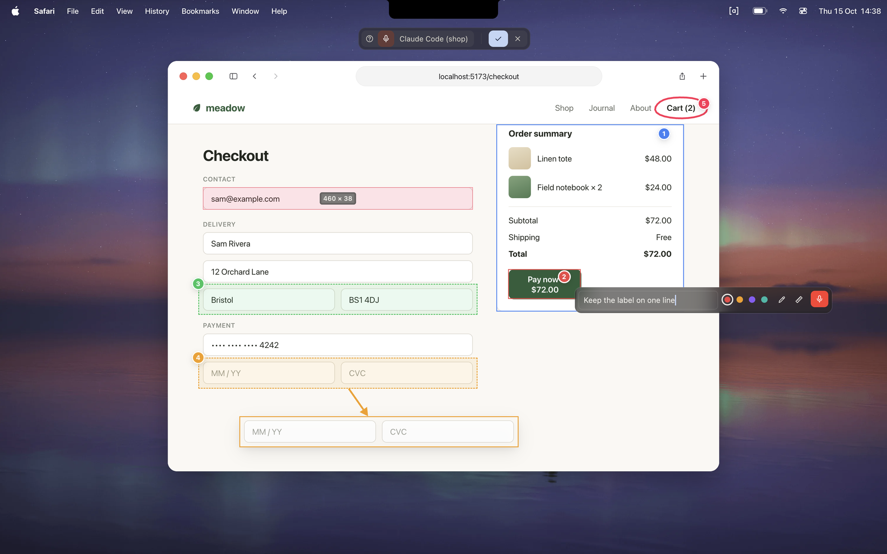

# asides

**Freeze your screen, click what's wrong, say why.** It lands in your coding agent's chat as your
own message, with the screenshot, the elements you clicked and what you measured. Transcribed
locally, on your Mac.



```
⌃⌥Space   freeze the screen (and start listening)
click     pin what's under the pointer; drag to pin an area; talk
⌃⌥Space   send it to the agent session you typed into last
```

- **Into the session you're already in:** Claude Code, Codex, OpenCode, Gemini CLI, Copilot CLI or
  Qwen Code, in Terminal, Ghostty or [Diri](https://diri.sh). Nothing to install in the agent.
- **For anything on screen:** pins name the element (`button "Save"`, and in browsers the page and
  a CSS-like location). Measure like PixelSnap, draw arrows, take partial screenshots.
- **Local and free:** [whisper.cpp](https://github.com/ggml-org/whisper.cpp) on your Mac's GPU. No
  account, no API key, no audio leaves your Mac.

## Install

macOS 14 or later, Apple silicon.

```bash
brew tap mihaicristianfarcas/asides https://github.com/mihaicristianfarcas/asides
brew install --cask mihaicristianfarcas/asides/asides
```

Or download the [disk image](https://download.asides.mihaicristian.dev/asides.dmg) and drag
asides to Applications. On first launch it offers to link the `asides` command into
`/usr/local/bin` (macOS may ask for your password).

### From source

Needs Rust, the Xcode Command Line Tools and CMake (`brew install cmake`).

```bash
git clone https://github.com/mihaicristianfarcas/asides && cd asides
make install   # ~/Applications/asides.app, and the command in ~/.local/bin
```

## Get started

1. Open asides. It lives in the menu bar as `[a]`.
2. Start your agent (`claude`, `codex`…) in Terminal, Ghostty or Diri, as usual.
3. In the app you're testing, press `⌃⌥Space`, click, talk, and press `⌃⌥Space` again.

The first time, click the pill's microphone to download a voice model (190 MB). Pins, measuring
and screenshots work without one.

## Documentation

- [Using asides](guide/using.md): the tools, keys, where asides go, the window and the command
- [Settings](guide/settings.md): `config.toml`
- [Privacy and permissions](guide/privacy.md)
- [Troubleshooting](guide/troubleshooting.md)
- [Contributing](CONTRIBUTING.md) and [Architecture](ARCHITECTURE.md)

## License

[MIT](LICENSE-MIT) or [Apache 2.0](LICENSE-APACHE), at your option. Contributions are dual licensed
the same way. The Whisper models are OpenAI's, under MIT, downloaded from
[Hugging Face](https://huggingface.co/ggerganov/whisper.cpp).
