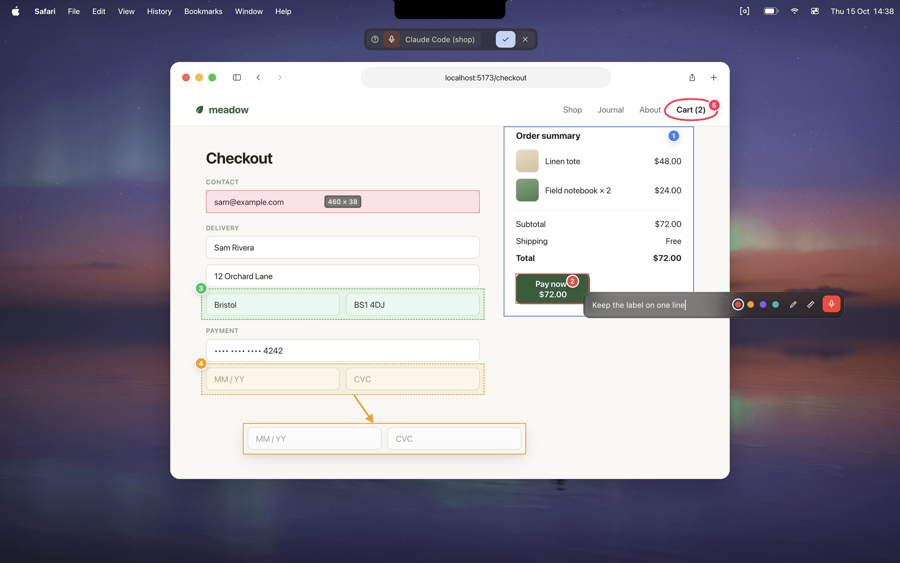

# asides

**Freeze your screen, click what's wrong, say why.** It lands in your coding agent's chat as your
own message, with the screenshot, the elements you clicked and what you measured. Transcribed
locally, on your Mac or PC.



```
⌃⌥Space   freeze the screen (and start listening)      Windows: Ctrl+Alt+Space
click     pin what's under the pointer; drag to pin an area; talk
⌃⌥Space   send it to the agent session you typed into last
```

- **Into the session you're already in:** Claude Code, Codex, OpenCode, Gemini CLI, Copilot CLI or
  Qwen Code, in Terminal, Ghostty or [Diri](https://diri.sh) (on Windows, any terminal). Nothing to
  install in the agent.
- **For anything on screen:** pins name the element (`button "Save"`, and in browsers the page and
  a CSS-like location). Measure like PixelSnap, draw arrows, take partial screenshots.
- **Local and free:** [whisper.cpp](https://github.com/ggml-org/whisper.cpp) on your Mac's GPU (on
  Windows, the CPU). No account, no API key, no audio leaves your computer.

## Install

macOS 14 or later, Apple silicon.

```bash
brew tap mihaicristianfarcas/asides https://github.com/mihaicristianfarcas/asides
brew install --cask mihaicristianfarcas/asides/asides
```

Or download the [disk image](https://download.asides.mihaicristian.dev/asides.dmg) and drag
asides to Applications. On first launch it offers to link the `asides` command into
`/usr/local/bin` (macOS may ask for your password).

### Windows

Windows 10 (2004) or 11, x64 or Arm64: run `asides-<version>-windows-<arch>-setup.exe` from the
[releases](https://github.com/mihaicristianfarcas/asides/releases) (no administrator needed), or,
before a release has one, build it with `scripts\package-windows.ps1` ([how](CONTRIBUTING.md#windows)).
It isn't signed yet, so Windows asks first (**More info**, **Run anyway**). On first launch asides
puts the `asides` command on your PATH. [What differs](guide/using.md#on-windows).

### From source

Needs Rust, the Xcode Command Line Tools and CMake (`brew install cmake`).

```bash
git clone https://github.com/mihaicristianfarcas/asides && cd asides
make install   # ~/Applications/asides.app, and the command in ~/.local/bin
```

## Get started

1. Open asides. Setup walks you through the permissions, the voice model (190 MB) and where new
   sessions open, or skip it. asides lives in the menu bar (or the notification area) as `[a]`.
2. Start your agent (`claude`, `codex`…) in Terminal, Ghostty, Diri or Windows Terminal, as usual.
3. In the app you're testing, press `⌃⌥Space`, click, talk, and press `⌃⌥Space` again.

Pins, measuring and screenshots work without a voice model; skipped, it's downloaded the first time
you click the pill's microphone.

## Documentation

- [Using asides](guide/using.md): the tools, keys, where asides go, the window and the command
- [Settings](guide/settings.md): `config.toml`
- [Privacy and permissions](guide/privacy.md)
- [Troubleshooting](guide/troubleshooting.md)
- [Contributing](CONTRIBUTING.md) and [Architecture](ARCHITECTURE.md)

## License

[MIT](LICENSE-MIT) or [Apache 2.0](LICENSE-APACHE), at your option. Contributions are dual licensed
the same way. The Whisper models are OpenAI's, under MIT, downloaded from
[Hugging Face](https://huggingface.co/ggerganov/whisper.cpp).
